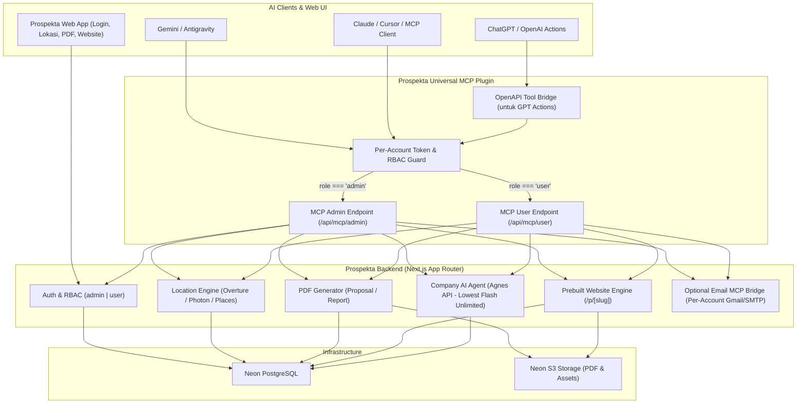

# Prospekta: Implementation Plan (Core Features, Company AI Agent, RBAC & Dual-MCP Plugin)

Dokumen ini adalah cetak biru implementasi teknis untuk menyederhanakan **Prospekta** ke 4 fitur inti (**Login, Lokasi, PDF, Website**), menghapus modul email bawaan dashboard, membangun **Company AI Agent** berbasis **Agnes API (Flash Tier Terendah / Unlimited)**, serta menyediakan **Universal MCP Plugin** berbasis **RBAC (`admin` & `user`)** yang dapat dihubungkan ke Gemini, ChatGPT/GPT, Claude, atau klien AI lainnya — lengkap dengan opsi integrasi **Email melalui MCP**.

---

## 1. Arsitektur Tingkat Tinggi



---

## 2. Matriks Ruang Lingkup Fitur (Keep vs Delete vs Build)

### 2.1 Fitur Dipertahankan & Dirapikan (4 Modul Inti)
| Modul | File / Route Utama yang Dipertahankan | Fungsi |
| :--- | :--- | :--- |
| **1. Login & RBAC** | `app/login/page.js`, `app/api/auth/*`, `lib/auth.js`, `lib/account.js`, `middleware.js` | Autentikasi akun, sesi cookie HMAC, penegakan 2 peran (`admin`, `user`), dan penerbitan token MCP per akun saat login. |
| **2. Lokasi** | `components/MapView.js`, `components/LocationPicker.js`, `components/MiniMapPicker.js`, `app/api/places/route.js`, `app/api/scan/route.js`, `app/api/anchors/route.js`, `app/api/geo/*`, `app/api/enrich/route.js`, `lib/geo.js`, `lib/enrich.js` | Pencarian bisnis berbasis radius/peta, manajemen anchor lokasi, enrichment metadata bisnis. |
| **3. PDF** | `components/ProposalViewer.js`, `app/api/reach/proposal/route.js`, `app/api/export/route.js` | Generate proposal/dokumen bisnis dalam format PDF siap unduh dan simpan ke Neon S3 Storage. |
| **4. Website** | `app/p/[slug]/page.js`, `components/PrebuiltSitesModal.js`, `app/api/reach/prebuilt-site/route.js`, `lib/design-engine.js` | Generate landing page / prototype website dinamis per prospek tanpa redeploy. |

### 2.2 Fitur Dihapus (Email Native Dashboard & Modul Non-Inti)
Seluruh fitur pengiriman email langsung, webmail inbox, auto-outreach, dan cron email dihapus dari UI dan backend inti:

- **UI Components untuk dihapus:**
  - `components/WebmailModal.js`
  - `components/AutoOutreachModal.js`
  - `components/SentOutreachModal.js`
  - Tab/section email & webmail di `components/ReachModal.js` dan `app/page.js`
- **API Routes untuk dihapus:**
  - `app/api/reach/ai-email/route.js`
  - `app/api/reach/bulk-outreach/route.js`
  - `app/api/reach/webmail/route.js`
  - `app/api/reach/webmail/draft-reply/route.js`
  - `app/api/reach/mcp/check-replies/route.js`
  - `app/api/cron/auto-outreach/route.js`
  - `app/api/cron/auto-followup/route.js`
  - `app/api/reach/sg/batch-assign/route.js`
  - `app/api/reach/sg/log-outreach/route.js`
  - `app/api/reach/sg/personal-leads/route.js`
  - `app/api/reach/sg/verify-lead/route.js`
  - `app/api/telegram/link/route.js` & `app/api/telegram/webhook/route.js`
- **Library untuk dihapus / dibersihkan:**
  - `lib/sg-outreach.js`
  - `lib/email-classifier.js`
  - `lib/email-verifier.js`
  - `lib/telegram.js`
  - `lib/email.js` -> dipindahkan fungsinya hanya untuk **verifikasi akun/reset password** (minimal) dan **MCP Email Tool opsional** (jika user mengaktifkan koneksi email via MCP).

### 2.3 Fitur Baru untuk Dibangun
1. **RBAC 2 Peran (`admin` dan `user`)** secara konsisten di database, sesi login, API, dan MCP.
2. **Company AI Agent Engine** memakai **Agnes API Key** (`AGENT_API_KEY`) dengan **model Flash tier paling bawah (unlimited)** + sistem pengetahuan (*knowledge base*) perusahaan.
3. **Dual MCP Server & Per-Account Token Management:**
   - **MCP Admin** (`/api/mcp/admin`)
   - **MCP User** (`/api/mcp/user`)
4. **Universal Plugin Package (`packages/prospekta-mcp-plugin/`)** yang dapat dipasang ke Gemini, ChatGPT/GPT (via OpenAPI Bridge), Claude, Cursor, dan klien MCP lainnya.
5. **Optional Email Connector via MCP** (`email_send`, `email_draft`, `email_list_recent`) yang terhubung per akun hanya melalui MCP.

---

## 3. Skema Database (Neon PostgreSQL)

Tambahkan/perbarui tabel berikut di [scripts/migrate-neon.js](file:///c:/Users/SSD/Documents/GitHub/prospekta/scripts/migrate-neon.js) pada database Neon yang bersih:

```sql
-- 1. Users dengan RBAC 2 peran tegas: 'admin' | 'user'
CREATE TABLE IF NOT EXISTS users (
  id TEXT PRIMARY KEY,
  email TEXT UNIQUE NOT NULL,
  name TEXT NOT NULL,
  password_hash TEXT NOT NULL,
  role TEXT NOT NULL DEFAULT 'user' CHECK (role IN ('admin', 'user')),
  is_active BOOLEAN NOT NULL DEFAULT TRUE,
  created_at TIMESTAMPTZ NOT NULL DEFAULT NOW(),
  updated_at TIMESTAMPTZ NOT NULL DEFAULT NOW()
);

-- 2. Token MCP per Akun (terikat langsung ke user_id dan role)
CREATE TABLE IF NOT EXISTS mcp_tokens (
  id TEXT PRIMARY KEY,
  user_id TEXT NOT NULL REFERENCES users(id) ON DELETE CASCADE,
  label TEXT NOT NULL DEFAULT 'Default MCP Plugin',
  token_hash TEXT UNIQUE NOT NULL,
  token_prefix TEXT NOT NULL,            -- contoh: 'psk_adm_...' atau 'psk_usr_...'
  scope TEXT NOT NULL CHECK (scope IN ('admin', 'user')),
  expires_at TIMESTAMPTZ,
  last_used_at TIMESTAMPTZ,
  revoked_at TIMESTAMPTZ,
  created_at TIMESTAMPTZ NOT NULL DEFAULT NOW()
);

-- 3. Konfigurasi & Knowledge Base Company AI Agent (hanya bisa diubah Admin)
CREATE TABLE IF NOT EXISTS agent_profiles (
  id TEXT PRIMARY KEY DEFAULT 'company_default',
  company_name TEXT NOT NULL DEFAULT 'Prospekta',
  system_prompt TEXT NOT NULL,
  knowledge_markdown TEXT NOT NULL DEFAULT '',
  model_id TEXT NOT NULL DEFAULT 'gemini-2.0-flash-lite',
  temperature DOUBLE PRECISION NOT NULL DEFAULT 0.2,
  updated_by TEXT REFERENCES users(id),
  updated_at TIMESTAMPTZ NOT NULL DEFAULT NOW()
);

-- 4. Koneksi Email Opsional via MCP per Akun (terenkripsi AES-256-GCM)
CREATE TABLE IF NOT EXISTS user_mcp_email_connectors (
  user_id TEXT PRIMARY KEY REFERENCES users(id) ON DELETE CASCADE,
  provider TEXT NOT NULL CHECK (provider IN ('smtp', 'gmail_oauth')),
  email_address TEXT NOT NULL,
  smtp_host TEXT,
  smtp_port INTEGER DEFAULT 587,
  credentials_enc TEXT NOT NULL,         -- app password / oauth refresh token terenkripsi
  is_enabled BOOLEAN NOT NULL DEFAULT FALSE,
  updated_at TIMESTAMPTZ NOT NULL DEFAULT NOW()
);

-- 5. Dokumen PDF terarsip per User
CREATE TABLE IF NOT EXISTS pdf_documents (
  id TEXT PRIMARY KEY,
  user_id TEXT NOT NULL REFERENCES users(id) ON DELETE CASCADE,
  place_id TEXT,
  title TEXT NOT NULL,
  storage_key TEXT NOT NULL,             -- path di Neon S3 Storage
  public_url TEXT,
  created_at TIMESTAMPTZ NOT NULL DEFAULT NOW()
);

-- 6. Audit Log Eksekusi MCP (keamanan & observabilitas)
CREATE TABLE IF NOT EXISTS mcp_audit_logs (
  id BIGSERIAL PRIMARY KEY,
  user_id TEXT REFERENCES users(id) ON DELETE SET NULL,
  role TEXT NOT NULL,
  endpoint TEXT NOT NULL,                -- '/api/mcp/admin' | '/api/mcp/user'
  tool_name TEXT NOT NULL,
  status TEXT NOT NULL,                  -- 'ok' | 'denied' | 'error'
  duration_ms INTEGER,
  created_at TIMESTAMPTZ NOT NULL DEFAULT NOW()
);
```

> **Catatan Isolasi Data:** Tabel `places`, `anchors`, `scans`, dan `prebuilt_websites` menambahkan kolom `owner_user_id TEXT REFERENCES users(id)` agar setiap query milik `user` otomatis terfilter `WHERE owner_user_id = $1`, sedangkan `admin` dapat melihat seluruh data.

---

## 4. Desain RBAC (2 Peran) & Alur Login

### 4.1 Matriks Hak Akses RBAC
| Fitur / Resource | `admin` | `user` |
| :--- | :---: | :---: |
| **Login & Profil Sendiri** | Ya | Ya |
| **Manajemen User (Create / Edit Role / Nonaktifkan)** | Ya | Tidak (`403`) |
| **Kelola Company AI Agent (Prompt & Knowledge Base)** | Ya | Read-only (via chat/tool) |
| **Lokasi (Scan, Anchor, Places)** | Semua akun | Hanya milik akun sendiri |
| **PDF (Generate, List, Download, Delete)** | Semua akun | Hanya milik akun sendiri |
| **Website (Generate `/p/[slug]`, Edit, Delete)** | Semua akun | Hanya milik akun sendiri |
| **MCP Admin (`/api/mcp/admin`)** | **Diizinkan** | **Ditolak (`403`)** |
| **MCP User (`/api/mcp/user`)** | **Diizinkan** | **Diizinkan (scoped `uid`)** |
| **Email via MCP (Opsional)** | Akun sendiri / konfigurasi global | Hanya akun sendiri (jika dihubungkan) |
| **Audit Log MCP** | Ya | Tidak (`403`) |

### 4.2 Alur Login Terikat MCP
1. User login melalui `POST /api/auth/login` dengan email & password.
2. Backend memverifikasi hash password di tabel `users`, mengambil `{ uid, email, role }` (`admin` atau `user`).
3. Backend menerbitkan session cookie HMAC (`prospekta_session`) yang memuat `{ uid, role, exp }`.
4. Di halaman dashboard / menu **MCP Plugin**, sistem otomatis menampilkan konfigurasi MCP **sesuai peran akun yang sedang login**:
   - Jika `role === 'admin'`: dapat membuat/mencabut token dengan prefix `psk_adm_` dan mengakses endpoint `/api/mcp/admin` (serta `/api/mcp/user`).
   - Jika `role === 'user'`: hanya dapat membuat/mencabut token dengan prefix `psk_usr_` yang secara kriptografis dan database terkunci ke endpoint `/api/mcp/user` dan `user_id` miliknya sendiri.
5. **Double-Layer Verification:** Setiap request MCP wajib memvalidasi:
   - Token valid & belum di-revoked (`revoked_at IS NULL`) di `mcp_tokens`.
   - User masih aktif (`users.is_active = TRUE`).
   - Role saat ini di tabel `users` cocok dengan endpoint yang dipanggil (jika admin diturunkan menjadi `user`, token `psk_adm_` lama otomatis ditolak).

---

## 5. Company AI Agent (Token API Agnes — Model Flash Terbawah / Unlimited)

### 5.1 Konfigurasi Environment
Di `.env.local`:
```env
# Agnes AI API (Model Flash Tier Terbawah / Unlimited)
AGENT_API_KEY="sk-kzNBKAxSntdcIzYPpdY85McO6UM1PSSTBWHamvhizg00G2fK"
AGENT_API_BASE_URL="https://api.agnes.ai/v1" # sesuaikan dengan base URL endpoint Agnes API Anda
AGENT_MODEL_ID="gemini-2.0-flash-lite"       # model flash tier paling bawah (unlimited)
```

### 5.2 Arsitektur Agent Perusahaan (`lib/company-agent.js`)
Buat adapter tunggal di `lib/company-agent.js` yang menggantikan pemanggilan multi-provider berat untuk tugas operasional:
1. **Model Selection:** Selalu memprioritaskan `process.env.AGENT_API_KEY` dengan `process.env.AGENT_MODEL_ID` (model flash tier paling bawah yang unlimited). Menggunakan format OpenAI-compatible `/chat/completions` (atau Gemini REST jika endpoint Agnes memakai format Gemini) agar mudah diganti cukup dari env.
2. **Company Training / Grounding (Tanpa Fine-Tuning Mahal):**
   - Memuat `agent_profiles` dari Neon DB (`system_prompt` + `knowledge_markdown` yang berisi profil perusahaan, daftar produk/layanan, gaya bahasa, SOP penawaran, dan FAQ).
   - Menginjeksi konteks peran pemanggil (`role: admin | user`) dan data real-time dari modul **Lokasi**, **PDF**, dan **Website**.
   - Menggunakan aturan **Antislop** (ringkas, faktual, tanpa buzzword AI) dan **OWASP LLM01 Quarantine** (`<untrusted_content>`) untuk data hasil scraping lokasi/website.
3. **Alur Pelatihan / Pembaruan Pengetahuan (Admin Only):**
   - Admin dapat memperbarui *Company Knowledge Base* (upload teks/markdown atau isi form di Dashboard Admin / via tool `admin_update_agent_knowledge` di MCP Admin).
   - Perubahan langsung aktif di seluruh panggilan AI Agent dan MCP tanpa perlu restart atau redeploy.

---

## 6. Arsitektur Dual-MCP (MCP Admin & MCP User) + Email via MCP

Implementasi menggunakan standar **Model Context Protocol (JSON-RPC 2.0 over Streamable HTTP)** langsung di Next.js App Router (tanpa perlu server terpisah), mengikuti prinsip *Ponytail* (ringkas, zero infrastructure overhead).

### 6.1 Endpoint Server
- **`POST /api/mcp/user`** — Endpoint MCP khusus peran `user` (juga dapat diakses `admin` untuk operasi personal).
- **`POST /api/mcp/admin`** — Endpoint MCP khusus peran `admin`. Menolak keras peran `user` dengan JSON-RPC error `-32003` (`HTTP 403`).
- **`GET /api/mcp/openapi.json`** — Skema OpenAPI 3.1 dinamis (terfilter sesuai Bearer token/role) agar **ChatGPT / Custom GPT Actions** dapat langsung mengimpor tools Prospekta tanpa middleware tambahan.

### 6.2 Katalog Tools — MCP User (`/api/mcp/user`)
Seluruh tool di bawah ini secara paksa menyuntikkan `context.userId` dari token auth (AI tidak bisa memalsukan `user_id` milik orang lain):

| Nama Tool | Modul | Deskripsi & Scope |
| :--- | :--- | :--- |
| `location_search` | Lokasi | Cari bisnis/lokasi berdasarkan koordinat, alamat, atau kata kunci radius. |
| `location_list_mine` | Lokasi | Daftar lokasi/prospek yang tersimpan milik akun login. |
| `location_enrich` | Lokasi | Ambil detail kontak, kategori, dan metadata bisnis untuk `place_id` milik user. |
| `pdf_generate` | PDF | Generate proposal/dokumen PDF dari data lokasi menggunakan Company AI Agent, simpan ke Neon S3, kembalikan URL unduh. |
| `pdf_list_mine` | PDF | Daftar dokumen PDF yang pernah dibuat oleh akun ini. |
| `website_generate` | Website | Generate prebuilt website `/p/[slug]` untuk sebuah lokasi prospek. |
| `website_list_mine` | Website | Daftar website preview yang dibuat oleh akun ini beserta statistik kunjungan. |
| `agent_ask` | AI Agent | Bertanya atau meminta analisis ke Company AI Agent (Agnes Flash Unlimited) menggunakan knowledge perusahaan. |
| `email_mcp_draft` *(Opsional)* | Email MCP | Membuat draf email penawaran berbasis data lokasi/PDF/website (tidak langsung kirim). |
| `email_mcp_send` *(Opsional)* | Email MCP | Mengirim email melalui konektor email pribadi akun (Gmail/SMTP) yang terhubung di `user_mcp_email_connectors`. Gagal jika akun belum menghubungkan email. |

### 6.3 Katalog Tools — MCP Admin (`/api/mcp/admin`)
Mewarisi seluruh tool operasional (dengan kemampuan melihat lintas akun) ditambah tool khusus administratif:

| Nama Tool | Modul | Deskripsi & Scope |
| :--- | :--- | :--- |
| `admin_users_list` | RBAC | Melihat seluruh akun terdaftar, status aktif, dan perannya (`admin`/`user`). |
| `admin_user_upsert` | RBAC | Membuat user baru, mengubah peran (`admin` <-> `user`), atau menonaktifkan akun. |
| `admin_mcp_tokens_manage` | MCP Security | Melihat daftar token MCP aktif semua user dan melakukan *revoke* instan. |
| `admin_agent_get_config` | AI Agent | Membaca system prompt, knowledge base perusahaan, dan model aktif Agnes API. |
| `admin_agent_update_knowledge` | AI Agent | Melatih/memperbarui knowledge base dan instruksi Company AI Agent secara langsung. |
| `admin_locations_list_all` | Lokasi | Mengakses seluruh data lokasi & hasil scan lintas semua user. |
| `admin_websites_list_all` | Website | Mengakses & mengelola seluruh prebuilt website `/p/[slug]` di sistem. |
| `admin_pdfs_list_all` | PDF | Mengakses seluruh arsip PDF lintas user. |
| `admin_audit_logs` | Security | Melihat riwayat pemanggilan tool MCP (siapa memanggil apa, status, durasi). |

### 6.4 Integrasi Email Opsional via MCP
Karena fitur email dihapus dari UI dashboard utama, integrasi email dirancang bersih di layer MCP:
1. User/Admin membuka halaman **Pengaturan Akun -> Koneksi Email MCP (Opsional)** dan menghubungkan akun emailnya (SMTP App Password atau Gmail OAuth).
2. Kredensial dienkripsi dengan `AES-256-GCM` memakai `SETTINGS_ENC_KEY` dan disimpan di `user_mcp_email_connectors`.
3. Ketika AI Client (Gemini/GPT/Claude) memanggil `email_mcp_send` melalui MCP, server Prospekta:
   - Memeriksa apakah `is_enabled = TRUE` untuk `user_id` tersebut.
   - Mendekripsi kredensial secara on-the-fly di memori.
   - Mengirim email dengan lampiran tautan PDF/Website Prospekta, lalu mencatat ke `mcp_audit_logs`.
4. Jika user tidak menghubungkan email, tool `email_mcp_send` tidak aktif dan tidak mengganggu 4 fitur inti lainnya.

---

## 7. Packaging Plugin Universal (Gemini, GPT, Claude, Cursor)

Buat folder `packages/prospekta-mcp-plugin/` berisi:
1. **CLI Bridge (`stdio` -> HTTP Proxy)** (`bin/prospekta-mcp.js`):
   - Sangat ringan (zero external dependency selain Node `fetch` bawaan), meneruskan stdin/stdout JSON-RPC ke `PROSPEKTA_MCP_URL` (`/api/mcp/admin` atau `/api/mcp/user`) dengan header `Authorization: Bearer <PROSPEKTA_MCP_TOKEN>`.
2. **Manifest Plugin (`plugin.json` / `mcp.json`)**:
   - Memudahkan instalasi 1-klik di berbagai ekosistem AI.

### Cara Koneksi ke Berbagai AI Client
| AI Platform | Metode Koneksi | Konfigurasi |
| :--- | :--- | :--- |
| **Gemini / Antigravity / Claude Desktop / Cursor** | Native MCP (Streamable HTTP atau `stdio` via `npx prospekta-mcp-plugin`) | URL: `https://<domain>/customer-reach/api/mcp/user` (atau `/admin`) + Header `Authorization: Bearer psk_...` |
| **ChatGPT / Custom GPT** | OpenAI Custom Actions (OpenAPI 3.1) | Import schema dari `https://<domain>/customer-reach/api/mcp/openapi.json` + Authentication Type: `Bearer Token` (`psk_...`) |
| **AI Agent / LangChain / n8n / Lainnya** | Standard MCP HTTP Client / REST JSON-RPC | Endpoint `POST /api/mcp/{role}` dengan Bearer Token akun |

---

## 8. Roadmap Eksekusi Bertahap

### Fase 1: Pembersihan Modul Email & Pengetatan 4 Fitur Inti
1. Hapus komponen dan API route email native (`WebmailModal`, `AutoOutreachModal`, `SentOutreachModal`, `/api/reach/webmail/*`, `/api/reach/ai-email`, `/api/reach/bulk-outreach`, `/api/cron/auto-outreach`, `/api/cron/auto-followup`, `/api/reach/sg/*`, `/api/telegram/*`).
2. Rapikan navigasi utama di `app/page.js` dan `components/ReachModal.js` agar hanya menampilkan 4 modul utama: **Lokasi**, **PDF**, **Website**, dan panel **Akun & MCP Plugin**.
3. Pastikan `npm run build` bersih tanpa broken import.

### Fase 2: Database Neon & RBAC 2 Peran (`admin` & `user`)
1. Perbarui `scripts/migrate-neon.js` dengan tabel `users`, `mcp_tokens`, `agent_profiles`, `user_mcp_email_connectors`, `pdf_documents`, `mcp_audit_logs`, dan kolom `owner_user_id`.
2. Jalankan migrasi ke Neon PostgreSQL (`node --env-file=.env.local scripts/migrate-neon.js`).
3. Perbarui `lib/auth.js` dan `app/api/auth/*` agar hanya mengenal role `admin` dan `user`, serta membuat guard helper `requireRole(request, 'admin' | 'user')`.
4. Tambahkan UI manajemen user (khusus `admin`) dan halaman profil/token MCP (untuk `admin` & `user`).

### Fase 3: Company AI Agent (Agnes API — Flash Unlimited)
1. Buat `lib/company-agent.js` yang memakai `AGENT_API_KEY` + model flash tier paling bawah (`AGENT_MODEL_ID`).
2. Hubungkan `app/api/reach/proposal/route.js` (PDF) dan `app/api/reach/prebuilt-site/route.js` (Website) agar memakai `lib/company-agent.js` sebagai engine default.
3. Buat halaman/modal **Company Agent Knowledge** (khusus `admin`) untuk mengisi dan memperbarui profil serta SOP perusahaan.

### Fase 4: Dual-MCP Server (`MCP Admin` & `MCP User`) + Email MCP Opsional
1. Buat core handler `lib/mcp/server.js` (JSON-RPC 2.0 router: `initialize`, `tools/list`, `tools/call`), `lib/mcp/auth.js` (validasi token + RBAC), `lib/mcp/tools-user.js`, `lib/mcp/tools-admin.js`, dan `lib/mcp/tools-email.js`.
2. Buat route:
   - `app/api/mcp/user/route.js`
   - `app/api/mcp/admin/route.js`
   - `app/api/mcp/tokens/route.js` (generate/list/revoke token per akun)
   - `app/api/mcp/openapi.json/route.js` (bridge untuk ChatGPT/GPT Actions)
3. Tambahkan form opsional **Koneksi Email via MCP** di pengaturan akun.

### Fase 5: Universal MCP Plugin & Verifikasi End-to-End
1. Buat paket `packages/prospekta-mcp-plugin/` (CLI `stdio` bridge + `README.md` panduan setup untuk Gemini, ChatGPT, Claude, Cursor).
2. Jalankan matriks pengujian verifikasi:
   - Login sebagai `user`: hanya melihat data sendiri, dapat generate token `psk_usr_`, panggilan ke `/api/mcp/user` berhasil, panggilan ke `/api/mcp/admin` ditolak `403`.
   - Login sebagai `admin`: dapat mengelola user & Company Agent Knowledge, panggilan ke `/api/mcp/admin` dan `/api/mcp/user` berhasil, seluruh eksekusi tercatat di `mcp_audit_logs`.
   - Uji tool `location_search`, `pdf_generate`, `website_generate`, `agent_ask`, dan `email_mcp_send` dari klien MCP (Gemini/Claude) serta OpenAPI Action (GPT).
   - Verifikasi `npm run build` lulus tanpa error.
